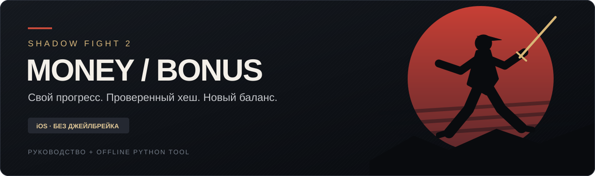

  

<h1 align="center">Shadow Fight 2 — iPhone Save Editor</h1>

<strong>Coins, gems, enchantment orbs and energy. No jailbreak. No coding.</strong>

  <a href="README.md">🇷🇺 Русский</a> · 🇬🇧 English

  <a href="https://github.com/richmanstudio/ShadowFight2MoneyBonus/releases/tag/v1.1.0"><strong>⬇️ DOWNLOAD — Stable version</strong></a>
  &nbsp; · &nbsp;
  <a href="docs/START_HERE_EN.md"><strong>📖 BEGINNER'S GUIDE</strong></a>

> [!IMPORTANT]
> **This is a Windows PC program, NOT an iPhone app.** You'll need a Windows computer, your iPhone, a cable and [iMazing](https://imazing.com/). **No jailbreak or programming skills needed.** iMazing is separate software; some of its features may require a paid license.

## What can I change?

| In the game | Status |
|---|---|
| 🪙 **Coins** | ✅ Confirmed on one iPhone |
| 💎 **Gems** | ✅ Confirmed on one iPhone |
| 🟢 **Green enchantment orbs** | ✅ Owner-confirmed on one iPhone |
| 🔴 **Red enchantment orbs** | ✅ Owner-confirmed on one iPhone |
| 🟣 **Purple enchantment orbs** | ✅ Owner-confirmed on one iPhone |
| ⚡ **Unlimited Energy** | ✅ Owner-confirmed on one iPhone |

**[⬇️ Download current v1.1.0 — coins, gems, orbs & energy](https://github.com/richmanstudio/ShadowFight2MoneyBonus/releases/tag/v1.1.0)**

[Older v1.0.0 — coins & gems only](https://github.com/richmanstudio/ShadowFight2MoneyBonus/releases/tag/v1.0.0)

On the release page, open **Assets**, download `SF2-Save-Editor-Windows.exe`, and run it on your **PC**.

**The project owner reports that coins, gems, enchantment orbs and unlimited energy worked on their iPhone.** This is a single-user, single-device confirmation, not a compatibility guarantee. Keep an untouched original backup.

## How it works — in plain English

**1. Save your progress.** Connect the iPhone to your PC, make a backup and use iMazing to export Shadow Fight 2 app data. You'll get a file like `original.imazingapp`. **Keep it safe.**

**2. Open it in the editor.** Click **Browse** and then **Verify archive and HASH**. That's simply an integrity check to make sure the save is usable.

**3. Enter the new values.** Choose your coin, gem or orb amounts and optionally enable unlimited energy, then click **Save as** and **Build .imazingapp**. The program creates a new copy and keeps the original.

**4. Restore the modified save.** In iMazing, choose **Restore App Data** and select your newly generated file. Your iPhone may restart and ask you to sign in to your Apple Account again.

**5. Go offline only for the first launch after importing.** Enable Airplane Mode and turn off Wi-Fi, launch SF2, finish a battle **or buy an item with in-game currency**, fully close the game, and then reconnect. Later launches can be normal.

**👉 [Full step-by-step beginner's guide](docs/START_HERE_EN.md)**

## ⚠️ Go offline ONCE after importing a modified save

**After each new save import, follow the owner's tested first-launch procedure:**

1. **Before the first game launch**, enable Airplane Mode **and separately turn Wi-Fi OFF**. Cellular internet must also be unavailable.
2. Open Shadow Fight 2 **offline**.
3. **Complete one battle OR buy a normal item using in-game currency.** No real-money purchase is needed. This gives the game an opportunity to write the updated state.
4. **Fully close the game** while still offline.
5. **Turn internet access back on.** You can launch the game normally afterward; Airplane Mode is **not required on every subsequent launch**.

**Repeat only after importing another modified save.** This is the project owner's reported successful procedure on one iPhone, **not** a guarantee about cloud synchronization on all devices. If prompted to choose cloud or local progress, compare them carefully instead of overwriting your save automatically.

## Frequently asked questions

<strong>Can I do it using only an iPhone?</strong>

No. You need Windows and iMazing to move your save data. This is not an iOS app.

<strong>Will I lose my progress?</strong>

The editor modifies selected values in **your own save**. But restoring a snapshot can roll back progress made after exporting it. Keep both an iPhone backup and the untouched `original.imazingapp`. We cannot guarantee against data loss.

<strong>Why does iMazing back up or restart my iPhone?</strong>

Those steps can be part of app-data export and restore. iOS may ask you to sign in to your Apple Account again. Follow iMazing and iOS instructions; do not uninstall the game or erase the phone yourself.

<strong>What if I get “Your game data may be corrupted”?</strong>

The save may fail an integrity check, or the game version might be incompatible. Don't delete the original file. See [Troubleshooting](docs/TROUBLESHOOTING_EN.md).

<strong>Is it free?</strong>

Our editor is free and open source. **iMazing is a separate product**, and some of its features may require a paid license.

<strong>Does it work on my iPhone?</strong>

One user-confirmed case: **original Shadow Fight 2 2.46.0, iOS 27.2, Windows + iMazing**. The owner reports successful coins, gems, enchantment orbs and unlimited energy on their iPhone. Compatibility with other devices or versions is not guaranteed.

## Want to look under the hood?

Regular players only need the **[beginner's guide](docs/START_HERE_EN.md)**. For developers and advanced users:

- [CLI / Python guide (Russian)](docs/GUIDE.md)
- [How the save hash works](docs/HASH.md)
- [Windows graphical editor guide](docs/GUI.md)
- [Editor source code](sf2save.py) · [Desktop UI source](gui.py)
- [Validation and limitations](docs/VALIDATION.md) · [MIT license](LICENSE)

Found a bug? [Open an issue](https://github.com/richmanstudio/ShadowFight2MoneyBonus/issues) with your game, iOS and iMazing versions. **Never share your real save, plist, device identifiers or Apple Account credentials publicly.**

---

*Independent project, not affiliated with Nekki, Apple or iMazing. Does not provide official purchases or modify server-side resources.*
