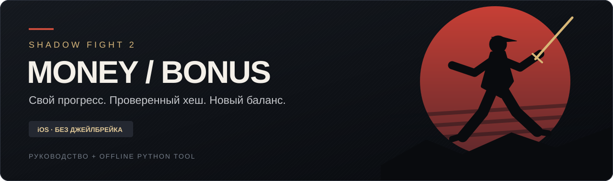

<p align="center"></p>

<p align="center">
  <a href="#что-проверено"></a>
  <a href="#что-проверено"></a>
  <a href="docs/HASH.md"></a>
  <a href="LICENSE"></a>
</p>

<h1 align="center">ShadowFight2MoneyBonus</h1>
<p align="center"><a href="README.en.md"><strong>🇬🇧 English README / English guide</strong></a> · <a href="docs/GUI.md"><strong>🖥️ Windows GUI / Интерфейс</strong></a> · <a href="https://github.com/richmanstudio/ShadowFight2MoneyBonus/releases"><strong>📦 Releases</strong></a></p>
<p align="center"><strong>Гайд по изменению монет и кристаллов в оригинальной Shadow Fight 2 на iOS<br>с сохранением своего действующего прогресса.</strong></p>

<p align="center"><a href="#быстрый-старт">Быстрый старт</a> · <a href="docs/GUIDE.md">Полный гайд</a> · <a href="docs/HASH.md">Как устроен хеш</a> · <a href="docs/TROUBLESHOOTING.md">Решение ошибок</a></p>

---

## Что делает проект

Вы экспортируете **своё текущее сохранение** через iMazing. Локальный Python-скрипт проверяет исходный хеш, меняет только `Money` и/или `Bonus`, обновляет основной и резервный XML вместе с их `.hash` и собирает новый `.imazingapp` для импорта.

**Без нового аккаунта, удаления игры, установки чужого сохранения и джейлбрейка.** Скрипт не подключается к интернету или iPhone и не требует Apple ID. Перенос данных выполняет iMazing; скрипт не заменяет его.

> [!IMPORTANT]
> «Сохранить прогресс» здесь означает сохранить состояние **на момент экспорта**. Бои, сыгранные после экспорта, с архивом не объединяются. Экспортируйте свежие данные, закройте игру и не продолжайте играть до завершения импорта.

## Что проверено

| Проверка | Результат |
|:--|:--|
| Оригинальная SF2 **2.46.0**, iOS **27.2**, компьютер Windows | Один подтверждённый пользовательский случай |
| Воспроизведение исходного `.hash` перед редактированием | Точное совпадение |
| Изменение `Money` и `Bonus`, импорт через iMazing | Пользователь подтвердил загрузку и работу |
| Остальной XML и прочие файлы архива | Проверяются программно |
| Бесконечная энергия и три вида сфер зачарования | Добавлены в редактор как **экспериментальные функции**, пока без теста на iOS |
| Снаряжение Титана и изменение сюжета | Не входят в проверенный сценарий |
| Другие версии iOS, SF2, другие устройства | Не подтверждены; обязательна проверка исходного хеша |

Это воспроизводимый опыт, а не обещание совместимости со всеми версиями. Подробнее: [границы проверки](docs/VALIDATION.md).

## Графический интерфейс для Windows

Для пользователей без опыта работы с терминалом есть **двуязычный GUI** (`gui.py`) на Python/Tkinter и самостоятельная Windows-сборка в [GitHub Releases](https://github.com/richmanstudio/ShadowFight2MoneyBonus/releases), если файл `SF2-Save-Editor-Windows.exe` опубликован в Assets.

В программе выберите свой **нетронутый** `.imazingapp`, нажмите **«Проверить файл и HASH»**, укажите `Money`/`Bonus`, при необходимости измените **три вида сфер** и включите **бесконечную энергию**, сохраните **новый** пакет и восстановите его через iMazing. Исходник не перезаписывается. Окно работает офлайн, а проверка хеша выполняется тем же модулем, что и CLI.

Запуск из исходников: `python gui.py` (Python 3.10+ с Tkinter). **Полное руководство:** [docs/GUI.md](docs/GUI.md). **English:** [README.en.md](README.en.md).

## Важно: каждый запуск изменённой игры — без интернета

> [!CAUTION]
> **Перед КАЖДЫМ запуском Shadow Fight 2 с изменённым сохранением полностью отключайте интернет на iPhone.** Включите **авиарежим**, затем отдельно проверьте, что **Wi-Fi выключен** (на iOS он может оставаться включённым даже в авиарежиме). Мобильная передача данных также должна быть недоступна. Отключайте связь **до открытия игры** и сохраняйте офлайн-режим всю игровую сессию.
>
> Это снижает риск, что при подключении к игровым сервисам игра предложит или загрузит **облачное сохранение вместо изменённого локального прогресса**. Точный механизм синхронизации зависит от версии игры; авиарежим **не гарантирует** защиту от всех проверок и не восстанавливает уже перезаписанные данные.
>
> Если игра уже открыта, полностью закройте её, отключите связь и только после этого запускайте снова. Сохраняйте нетронутый `original.imazingapp` для восстановления.

## Быстрый старт

Понадобятся компьютер с **Python 3.10+**, iMazing и iPhone с установленной SF2. Дополнительные Python-пакеты не нужны. Доступность функций и условия использования iMazing определяет его разработчик.

1. Сделайте резервную копию iPhone и **свежий экспорт данных SF2** в `original.imazingapp`. Сохраните исходник отдельно. [Подробная инструкция →](docs/GUIDE.md)
2. Скачайте репозиторий: **Code → Download ZIP**, распакуйте и откройте терминал в папке с `sf2save.py`.
3. Проверьте исходный архив:

```powershell
python sf2save.py verify "D:\SF2\original.imazingapp"
```

Продолжайте только при `"original_hash_verified": true`. Если проверка не прошла, скрипт не должен создавать исправленные хеши наугад.

4. Создайте отдельный изменённый архив:

```powershell
python sf2save.py patch "D:\SF2\original.imazingapp" --output "D:\SF2\modified.imazingapp" --money 10000000 --bonus 1000
```

Это **умеренные тестовые значения, а не установленные максимумы игры**. Разделители тысяч и кавычки внутри чисел не нужны. Чтобы изменить только кристаллы, укажите только `--bonus`.

5. Закройте SF2 на iPhone. В iMazing выберите **Manage Apps → Device → Restore App Data**, укажите `modified.imazingapp` и следуйте текущим инструкциям программы для вашей версии iOS. **Перед первым и каждым последующим запуском** включите авиарежим и отдельно выключите Wi-Fi. После восстановления откройте SF2 без интернета и проверьте баланс, уровень и карту. [Полный порядок действий и откат →](docs/GUIDE.md)

## Новые функции: сферы и бесконечная энергия (экспериментально)

Редактор поддерживает три вида сфер зачарования:

| Цвет | Поле в `users.xml` | Где хранится |
|---|---|---|
| 🟢 Зелёные | `ForgeMaterial1` | `Warrior/Currencies` |
| 🔴 Красные | `ForgeMaterial2` | `Warrior/Currencies` |
| 🟣 Фиолетовые | `ForgeMaterial3` | `Warrior/Currencies` |

Если `ForgeMaterial3` ещё отсутствует, инструмент может **добавить его** в уже существующий тег `Currencies`, не меняя уровень или сюжет. Для бесконечной энергии добавляется предмет `Unlimited_Energy` в список `Warrior/Items` (повторный запуск не создаёт дубликаты). Основная и резервная пары XML/HASH пересчитываются автоматически.

Пример с новыми параметрами:

```powershell
python sf2save.py patch "D:\SF2\original.imazingapp" --output "D:\SF2\custom.imazingapp" --orb-green 100000 --orb-red 50000 --orb-purple 10000 --unlimited-energy
```

> [!WARNING]
> Эти поля обнаружены в сохранениях/исследованиях Shadow Fight 2, но **изменение сфер и добавление бесконечной энергии ещё не проверены в игре на iOS**. Проверена только корректность XML, алгоритма HASH и сборки архива. Перед импортом сохраните оригинальный `.imazingapp` и резервную копию телефона. Начните с небольших значений. После восстановления соблюдайте режим полного офлайна перед каждым запуском игры.

[Открыть инструкцию по GUI](docs/GUI.md) · [Подробный гайд](docs/GUIDE.md)

## Почему простая замена числа вызывает ошибку

```text
users.xml         ─── изменение валюты ───► users.xml         + новый .hash
       │                                           │
       └── проверить старый .hash                   └── копия в users_backup.xml
                                                       + новый резервный .hash
```

`users.xml.hash` — не обычный MD5 файла. Расчёт учитывает нормализованный XML, значение идентификатора из конкретного экспорта, идентификатор приложения и постоянный суффикс. Старый `.hash` после правки валюты не подходит.

Скрипт ищет кандидаты идентификатора **только в ваших локальных plist** и выбирает значение, которое точно воспроизводит исходный хеш. Само присутствие UUID в настройках ничего не доказывает. Формула, пример кода и ограничения нормализации описаны в [HASH.md](docs/HASH.md).

## Команды

| Команда | Действие |
|:--|:--|
| `inspect ARCHIVE` | Показывает валюту, уровень, зону и SHA-256 XML без проверки хеша |
| `verify ARCHIVE` | Проверяет ZIP, исходный `.hash` и при наличии резервную пару |
| `patch ARCHIVE --output NEW --money N --bonus N` | Создаёт новый архив после проверки исходного хеша |
| `--orb-green N --orb-red N --orb-purple N` | Меняет количество трёх видов сфер (экспериментально) |
| `--unlimited-energy` | Добавляет предмет бесконечной энергии (экспериментально) |

`verify` и `patch` принимают необязательный `--device-value VALUE`, если значение уже известно. Оно всё равно проверяется по исходному `.hash`. Не используйте UUID из чужих инструкций.

## Что сохраняется

- Исходный архив никогда не перезаписывается; существующее имя результата также не перезаписывается.
- В основном XML изменяются только атрибуты выбранного персонажа `Money` и/или `Bonus`. Уровень, опыт, предметы и история боёв остаются прежними.
- Резервный XML становится копией изменённого основного XML; его прежняя версия остаётся в исходном архиве.
- Все остальные записи, включая `.lock`, plist и бинарные настройки, сохраняют своё содержимое. Упаковка ZIP может измениться; сами посторонние файлы — нет.
- Оба итоговых XML получают соответствующие им `.hash`; после сборки повторно проверяется архив.

## Ограничения

У проекта нет подтверждённого «безопасного максимума» валют. `2 147 483 647` не установлен как предел SF2. Поздняя сюжетная валюта может использовать масштаб `DenominationDigits`; не меняйте его вслепую. Точная версия сохранения важнее размера суммы.

Редактирование локального баланса не означает получение подтверждённых покупок, серверных ресурсов или рейтинга. Редактор не меняет платёжные записи, серверные данные и исполняемый файл игры. Корректный хеш не гарантирует прохождение всех проверок клиента или сервера.

## Приватность

Не публикуйте `.imazingapp`, `users.xml`, plist, пароли резервных копий и идентификаторы устройства. Они могут содержать данные аккаунта и другие личные сведения. В репозитории есть только код, документация, оригинальная обложка и **искусственные тестовые данные**. Скрипт не отправляет телеметрию и не выводит найденное значение идентификатора.

## Проверка кода

```powershell
python -m unittest discover -s tests -v
```

Проверяются отказ при неверном исходном хеше, сохранение исходника, изменение только валюты, согласованность резервной пары, неизменность прочих файлов и отказ от небезопасных или неоднозначных архивов. Синтетические тесты не заменяют проверку на устройстве.

## Источники и авторство

- [iMazing: экспорт и восстановление данных приложений](https://imazing.com/guides/how-to-export-backup-and-transfer-ios-apps-data-and-settings) — процедура переноса.
- [moltinginstar/sf2mod: исследование алгоритма хеша](https://github.com/moltinginstar/sf2mod/blob/main/WRITEUP.md) — исходная публикация исследования для Android. Этот проект отдельно воспроизвёл хеш на одном iOS-экспорте; Android-специфичные шаги переподписи APK здесь не используются.
- [Документация проекта](docs/GUIDE.md) — практический сценарий для своего текущего прогресса.

Независимый проект, не связанный с Nekki, Apple или iMazing. Названия продуктов принадлежат их владельцам. Код и оригинальное оформление опубликованы по [MIT](LICENSE).
